## 图的基本概念
### 图的定义
图是由顶点(Vertex)的有穷非空集合和定点之间边(edge)的集合组成的。
通记为G(V,E),V(G),V(E)通常表示图G的顶点集合和边集合。
对于图这种数据结构，不允许没有定点，但边集可以为空.

有向图与无向图
V(G)={0,1,2,3}
E(G)={(0,1),(0,2),(0,3),(1,2),(1,3),(2,3)} 无向图
E(G)={<0,1>,<1,2>,<1,0>} 有向图

简单图与多重图
限制1：图中不能有顶点到其自身的边。
限制2: 同一条边在图中不能出现两次或两次以上。
不满足以上两条限制的任意一个或两个的图成为多重图。
满足以上两条限制的成为简单图，通常研究简单图。

完全图：具有最多边数的图。
对于一个具有n个顶点的无向图，边数最大值为(n-1)n/2
对于一个具有n个顶点的有向图，边数最大值为(n-1)n

路径：从一个顶点开始，经过一系列的边到达另外一个顶点形成的顶点序列。
路径长度：路径上边的条数。
回路（环）：起点和终点相同，路径{0,3,1,0}是一个回路（环）。

简单路径：如果路径中不出现相同的顶点，则成为简单路径。
简单回路：除第一个和最后一个顶点外，其余顶点不重复的回路成为简单回路。

顶点的度：
-对于无向图，顶点的度指的是与顶点相关联的边的数目。
-入度：在有向图中，对于顶点v，箭头指向v的边的数目。
-出度：在有向图中，对于顶点v，从该顶点出发的边的数目。

度与边的关系：
- 无向图中，假设有n个顶点，e条边
所有顶点度数之和等于边数的两倍。
- 有向图中，所有顶点的出度之和与入度之和相等，弧的数量也相等。

子图：
图G的子图H满足：V(H)是V(G)的子集且E(H)是E(G)的子集。

连通图：
连通：在无向图中，如果从顶点V到顶点W有路径，则称顶点V到顶点W是连通的。
如果图中任意两个顶点都是连通的，则称此图为连通图。

连通分量：无向图中的极大连通子图成为连通分量。
连通分量为子图。
子图为连通图。
连通图含有极大的顶点数。
具有极大顶点数的连通子图包含依附于这些顶点的所有边。

强连通图：在有向图中，对于每一对顶点v和w，从v到w和从w到v都有路径，则称该有向图为强连通图。
有向图中的极大强连通子图成为有向图的强连通分量。

生成树：子含有图中全部顶点的极小连通子树。
注意：包含所有顶点n，但只有足以构成一棵树的n-1条边。

边的权和网：在一个图中，每条边可以标注上一个代表某种含义的数值，该数值称为这个边的权值。
网：边上带的权值的图，也称为带权图。

### 图的存储
1. 邻接矩阵
<邻接矩阵图无向>
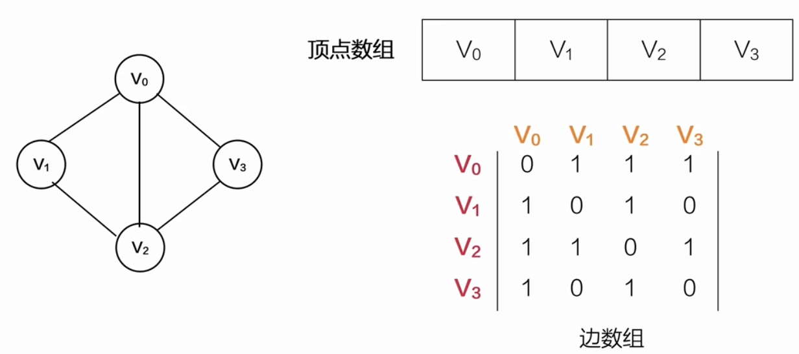

<邻接矩阵有向>
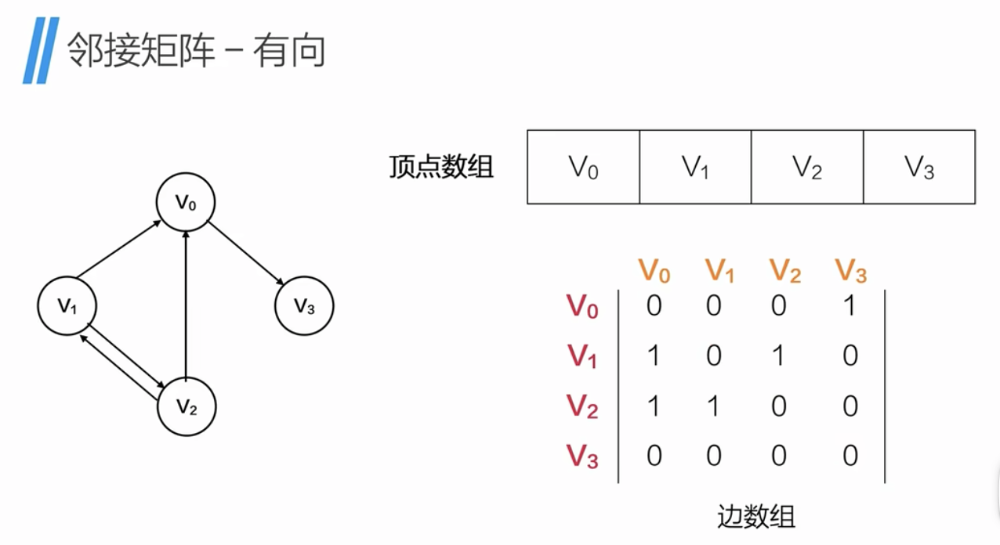

<邻接矩阵带权值>
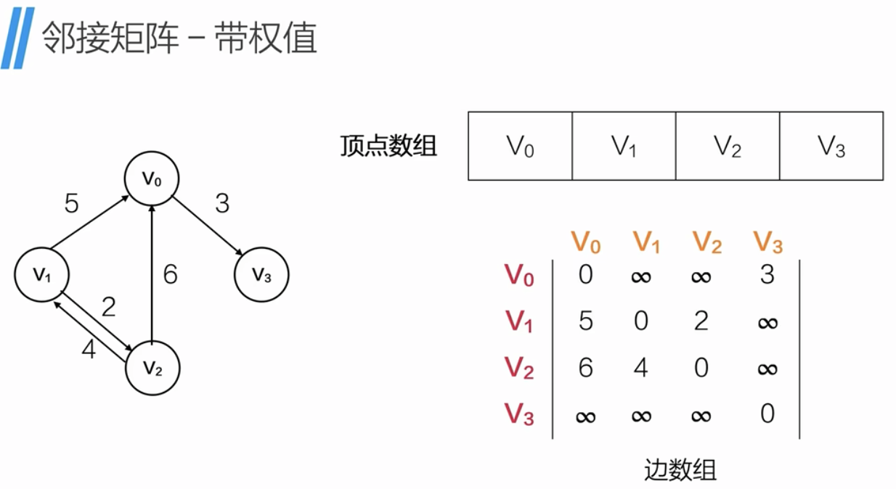

2. 邻接表
<邻接表无向>
这种表示方法有重复的边，造成了存储空间浪费。
有向图中空间浪费的问题通过十字链表解决。
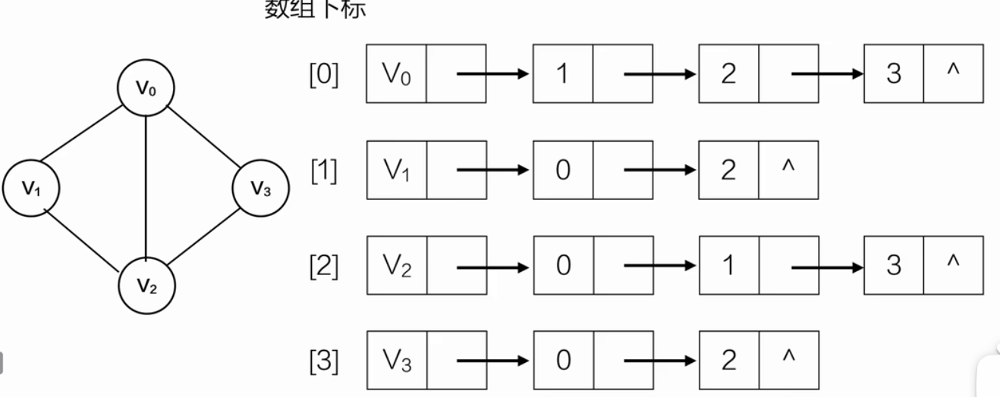

<邻接表有向-出边方向>
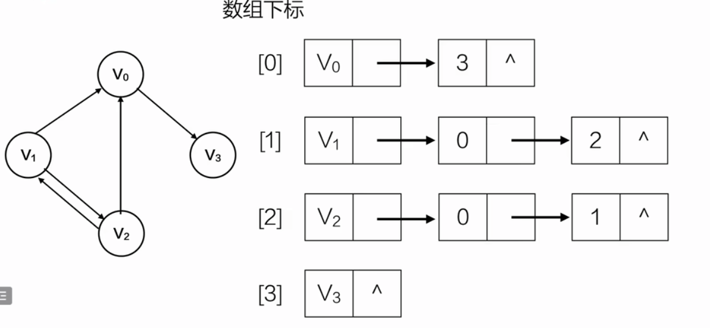

<逆邻接表有向-入边方向>
可以在结构题中加一个成员表示权值
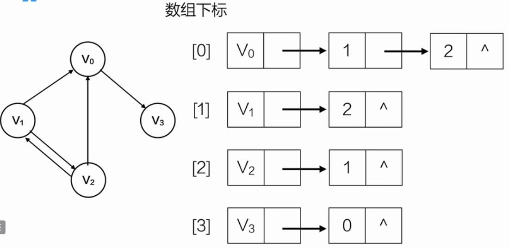
3.十字链表
<定义>
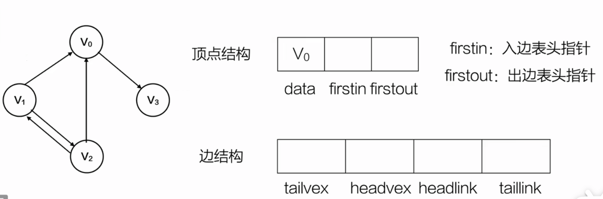

<举例>

4. 邻接多重表
用于解决无向图邻接表中存储空间浪费的问题
<定义>

<初始一个多重邻接表>
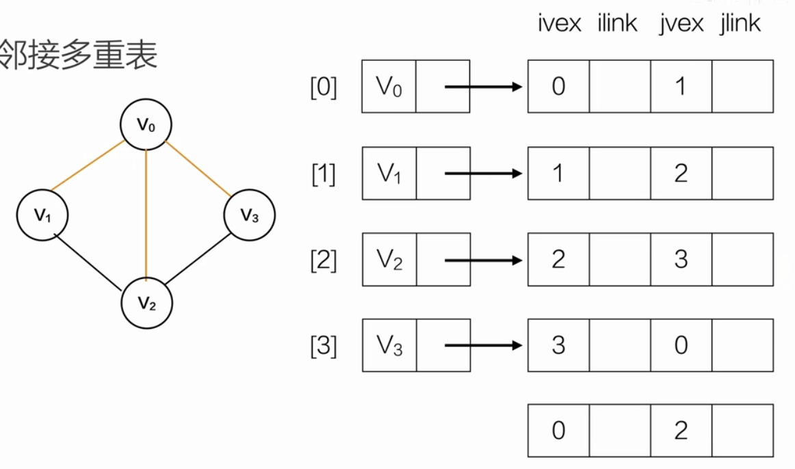

分别添加v0-v3的邻接表
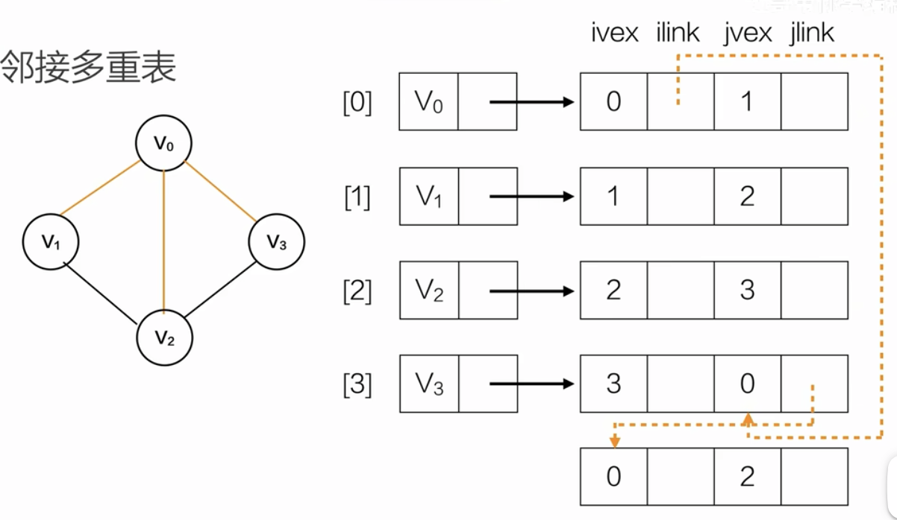

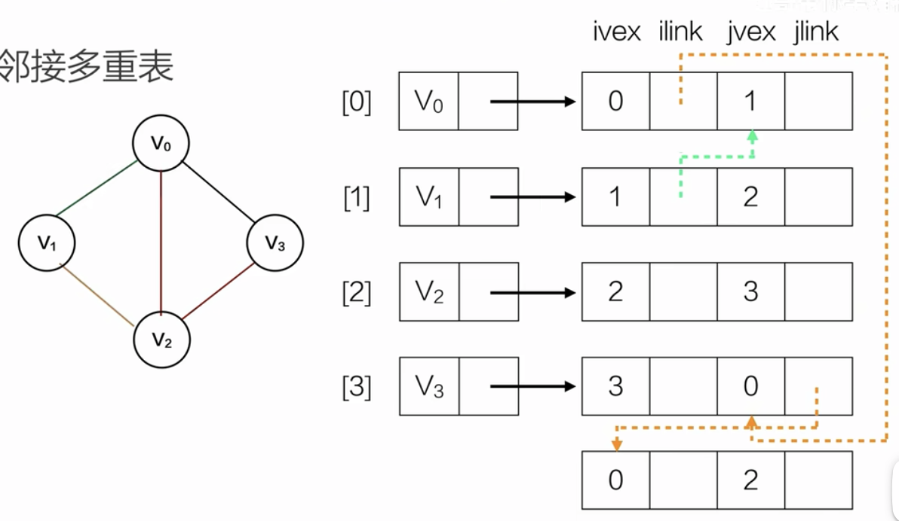

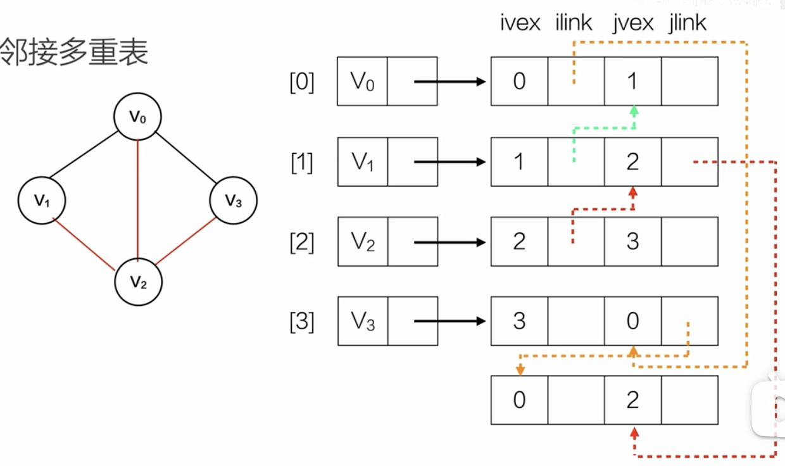

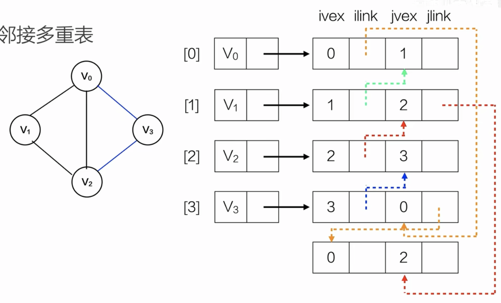