## 深度优先遍历
类似于树的前序遍历

## 广度优先遍历
类似于树的层序遍历

通过这个图看深度优先、广度优先的例子
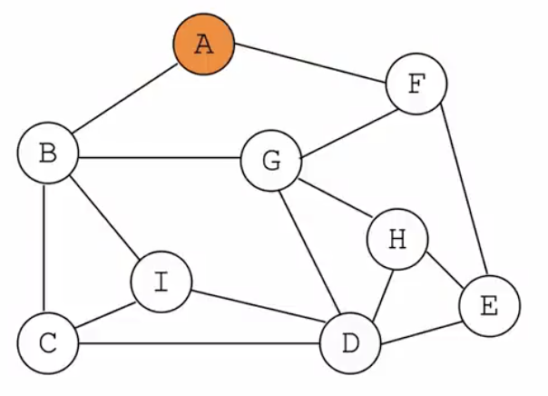

## 最小生成树算法
### Prim（普里姆）

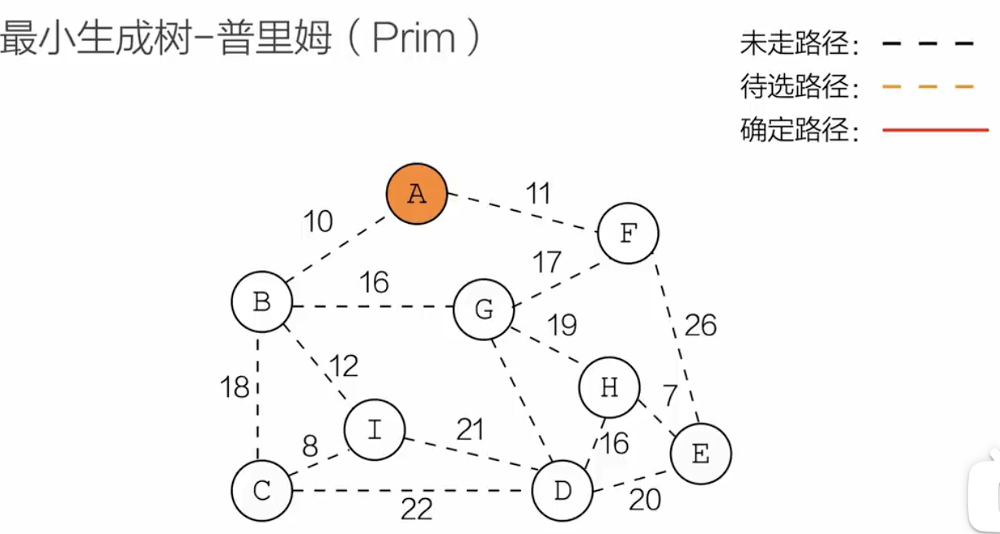

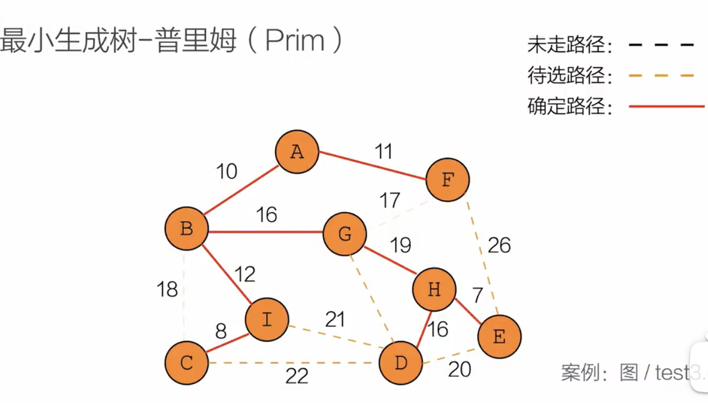

### 可鲁斯卡尔（Kruskal）

### 最小生成树性质
- 最小生成树的顶点数n和边数之间关系:n=e+1
- Kruskal算法针对边，当边数小时效率较高，对稀疏图有优势，时间复杂度O($elg^e$),e是边数
- Prim算法对边数多的情况，效率好一些。时间复杂度O($n^2$),n是顶点

## 最短路径(Dijkstra) 

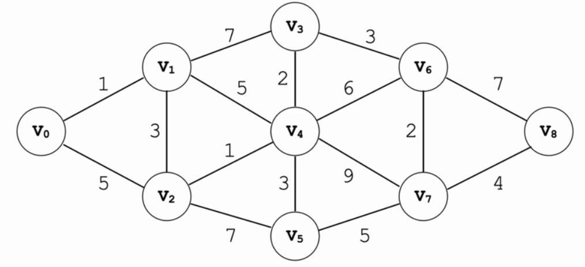

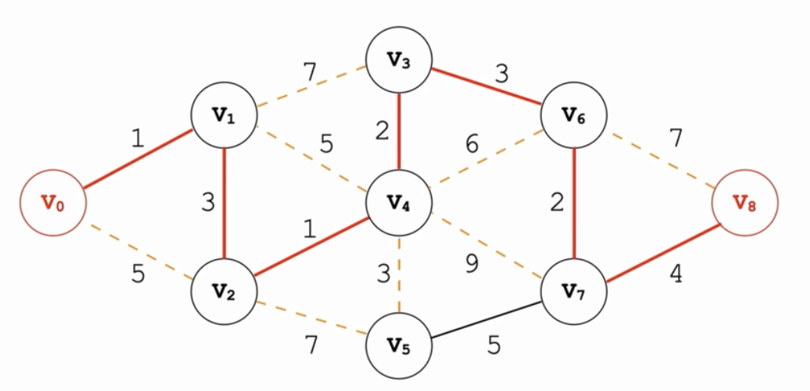

## 最短路径(Floyd)
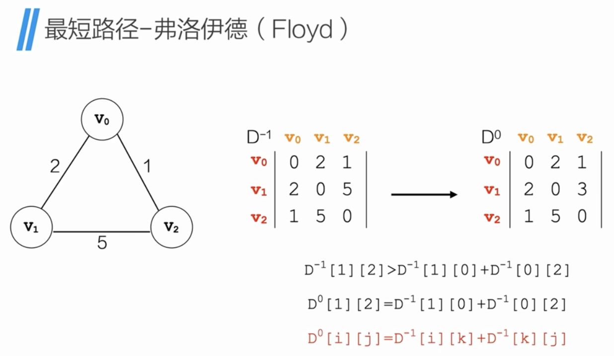
如图: $D^{-1}$表示的权值矩阵为初始矩阵，列为起点，行为终点，$D^{0}$为经过v0中转后，v1->v2的权值发生了改变。
Floyd算法就是不停地找这个中转点.

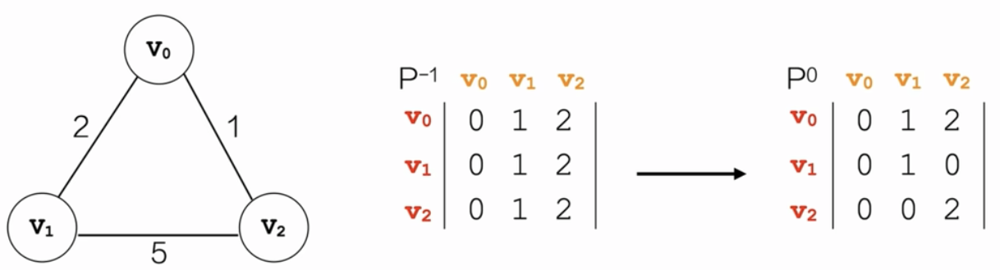
如图：$P^{-1}$表示从起点到终点经过了哪个点，如果没有中转点，就是终点。$P^{0}$中，从v1到v2经过了v0中转，[1][2]为0。

## 拓扑排序
在一个表示工程的有向图中，用顶点表示活动，用弧表示活动之间的优先级，这样的有向图为顶点表示活动的网，我们称为AOV网（Activity on Vertex Network)。
在一个表示工程的有向图中，用顶点表示事件，用有向边表示活动，用边上的权值表示活动的持续时间，这种有向图的边表示活动的网，我们称为AOE网(Activity on Edge Network)。如下图：
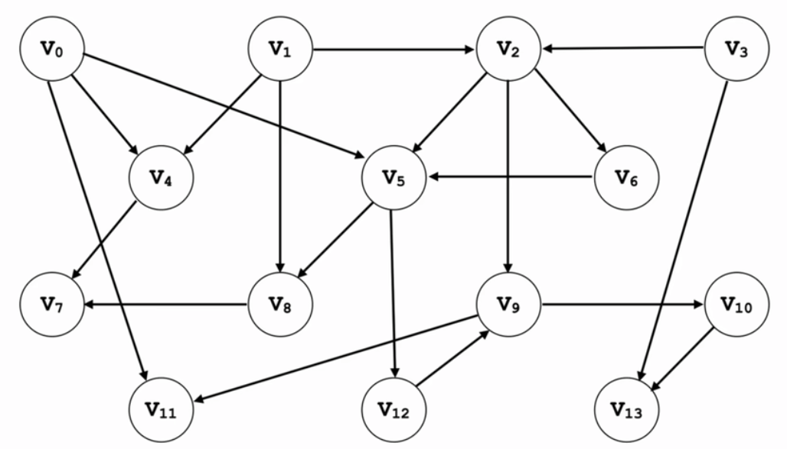
持续寻找入度为0的顶点，然后如栈、出栈。

算法实现的关键是将图的邻接矩阵表示转化为邻接表的表示，如下是邻接矩阵和邻接表
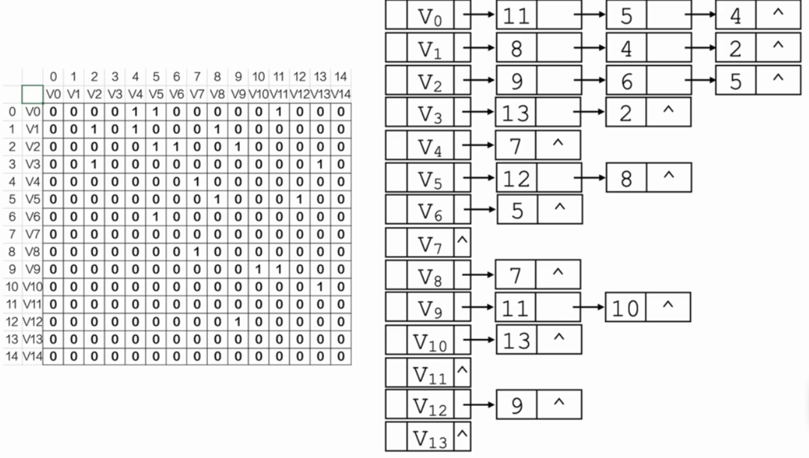

数据结构：
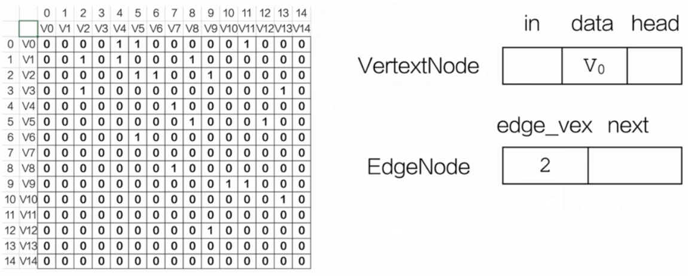

VexNode 和EdgeNode的例子：
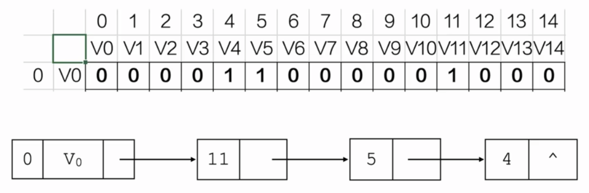

## 关键路径
在一个表示工程的有向图中，用顶点表示事件，用有向边表示活动，用边上的权值表示活动的持续时间，这种有向图的边表示活动的网，我们称为AOE网（Activity on Edge Network)。注意：带权值的图称为网。如下图：
它依然要用拓扑排序的代码来实现。
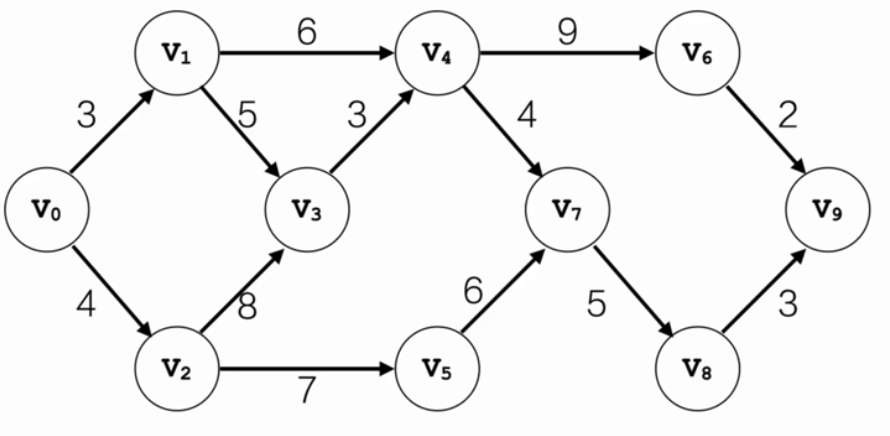

etv:事件最早发生的时间（earliest time of vertex),从前往后推.
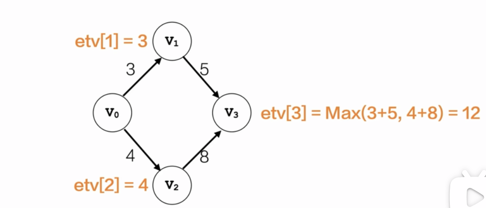

顶点带etv的图：
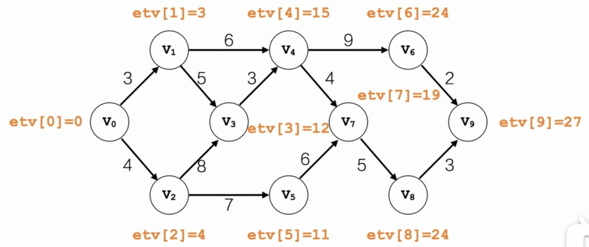

ltv:事件最晚发生的事件（latest time of vertex),从后往前推.
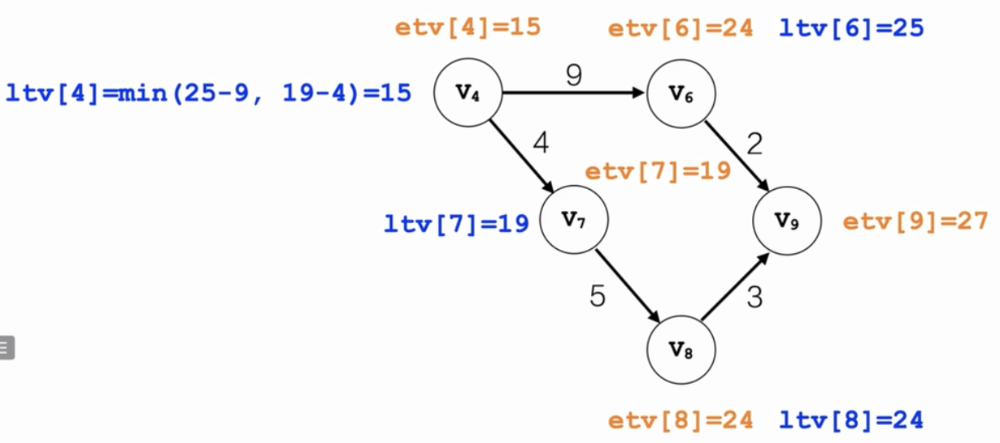

关键路径：etv=ltv的顶点构成的路径
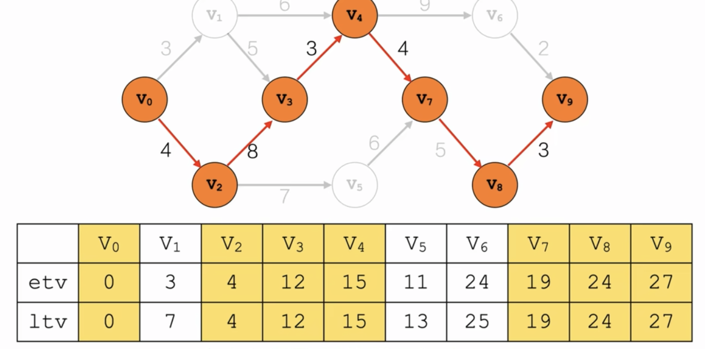