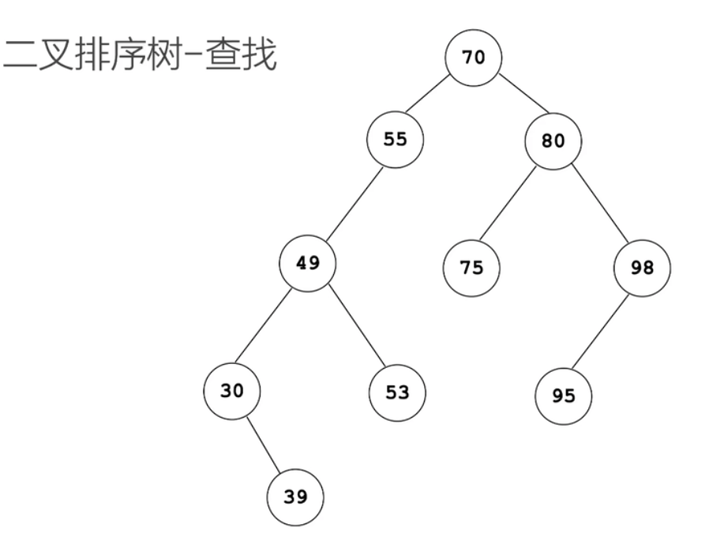
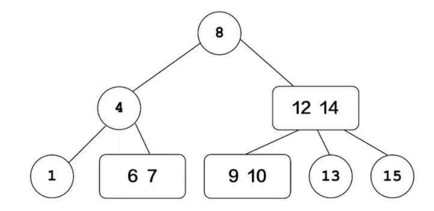
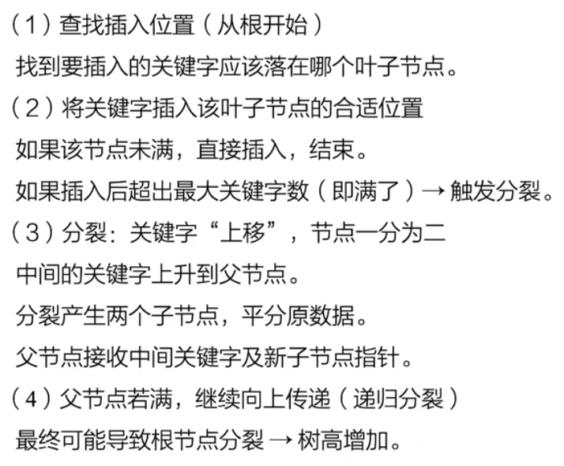
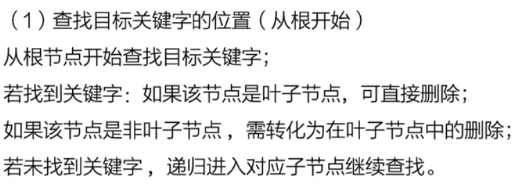
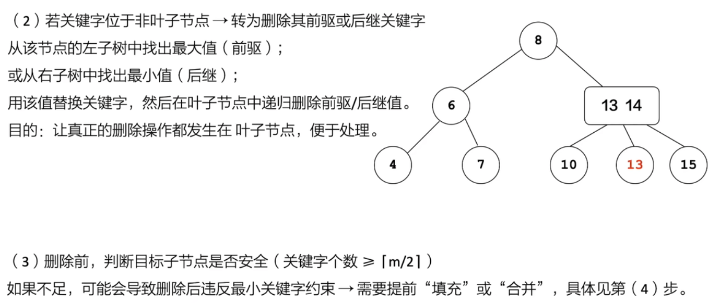
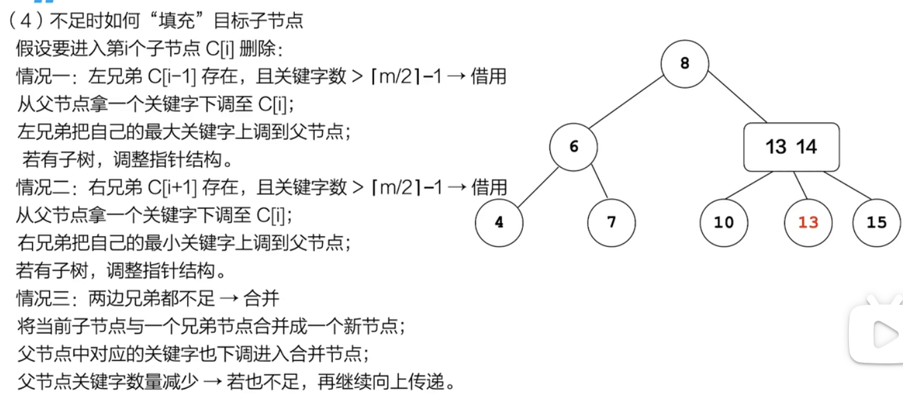
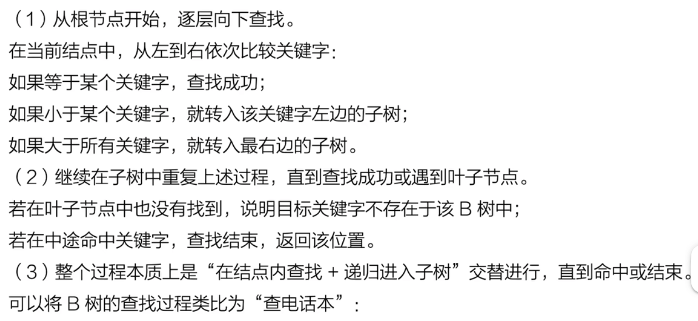
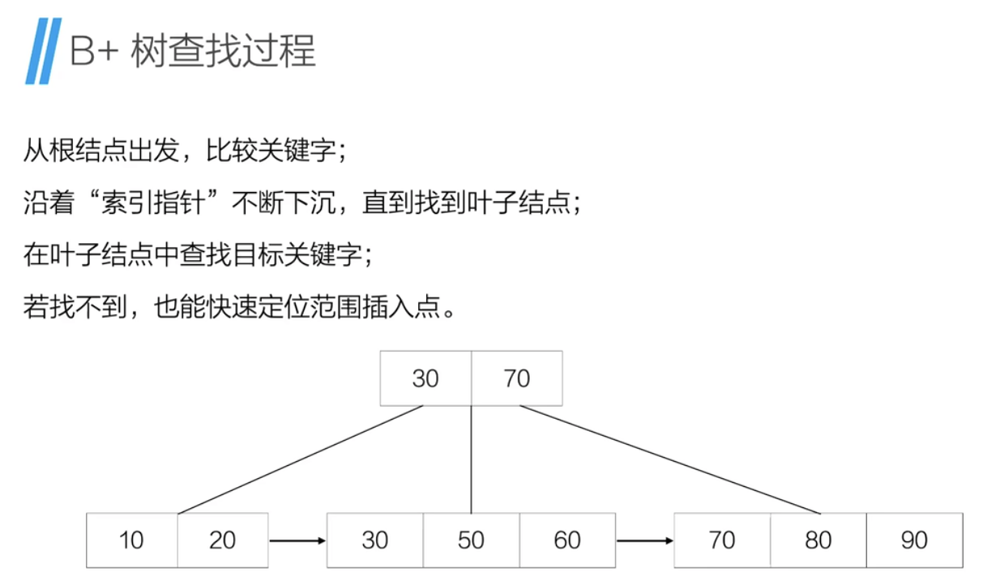
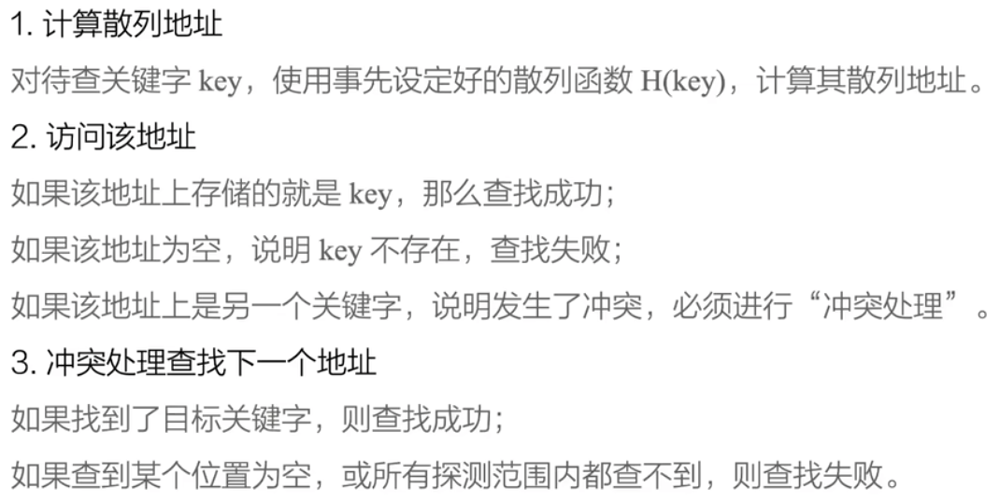

## 顺序查找

### 基本概念
- 查找表：由一组具有相同数据类型的元素组成的集合，这些元素通常保存在一张结构化的数据表中，用于支持对其中元素的查找操作。
可以吧查找表理解成一个“装着数据的仓库”，就像超市货架那样。想找商品（数据），就要在相应的数据表中查找它在哪儿。而查找表的作用，
就是为了方便找商品（数据）。

- 关键字：数据元素中能唯一标识该元素的属性值，查找的时候就是通过关键字来定位对应的数据元素。

- 查找：在查找表中根据给定的关键字燥处对应数据元素的过程。

- 平均查找长度：是指在一种查找方法下，查找一个元素所需比较的关键字的平均次数，是衡量查找算法效率的一个重要指标。
它通常分为查找成功和查找失败两种情况来讨论。

$$ASL_{success}=\Sigma_{i=1}\to{n}P_{i}C_{i}$$
如果表中有n个元素，第i个元素被查到的概率为$P_i$, 查找它需要比较$C_i$次关键字。
假设每个记录的查找概率相等$P_i=\frac{1}{n}$,那么$ASL_{success}=\frac{n+1}{2}$, $ASL_{success}=n$

### 查找算法
#### 顺序查找
依次比较，直至找到包含关键字的元素，返回其下标。

#### 折半查找（二分查找）
二分查找的前提是查找表必须是有序的。无序的数据表使用折半查找完全没有意义。

顺序查找效率较低，2而折半查找又依赖于有序的顺序表结构。有没有一种查找结构，既能保持较高的查找效率，又能在动态插入和删除
时保持结构的有序性？

#### 二叉排序树（Binary Search Tree， BST）
构造BST的目的，并不是为了排序，而是为了提高查找、插入以及删除关键字的速度。如下图：

<Bst-1.png>

#### 折半查找判定树
和二叉排序树类似。
折半查找和二叉排序树的时间复杂度都和树的深度相关，最多的查找次数就是树的深度。
具有n个结点的完全二叉树的深度为$[log_2^n]+1$,
所以，折半查找时间复杂度为$O(log_2^n)$
二叉树的查找时间复杂度为O(n).
二叉排序树的形态和输入的数据有关。

为了解决这个问题，平衡二叉树(Balanced Binary Search Tree)应运而生. 称为AVL树
#### 平衡二叉树
平衡二叉树(Balanced Binary Tree)又称AVL树，是一种二叉排序树，任意一个节点的左子树和右子树的高度差的绝对值不超过1.
平衡因子(Balanced Factor)是衡量节点平衡程度的指标。平衡因子=左子树高度-右子树高度
平衡二叉树平衡调整
- 最小不平衡子树：从插入点向上回溯，第一个失衡的点，对失衡的平衡二叉树进行调整时，需要先找到最小不平衡子树。
LL型失衡：插在左子树的左子树。找到第一个失衡点的左孩子，以它为轴旋转。
RR型失衡：插在右子树的右子树。找到第一个失衡点的右孩子，以它为轴旋转。
LR型失衡：插在左子树的右子树。
RL型失衡：插在右子树的左子树。

### B树（B-树）
在现实中，很多查找操作并不是在内存中完成的，而是要访问磁盘或数据库。相比内存，磁盘的读写代价非常高，必须尽可能地减少查找过程中磁盘的访问次数。此时，二叉排序树就显得力不从心了，因为其高度容易过大，导致频繁的磁盘访问。
为了解决这个问题，提出了一种多路平衡查找树-B树（Balanced Tree 或Bayer Tree）。

简单理解，B树是“多路版本”的平衡查找树，或者叫“平衡多叉树”。如果将二叉排序树看成是“每个节点最多两个分支”的树，那么B树允许每个节点有多个关键字和多个孩子，这种结构能有效压缩树的高度。

#### B树的性质
上图是一个3阶B树，一个m阶B树有如下性质：
- 每个节点最多有m个孩子；
- 每个非根非叶子节点至少有[m/2]个孩子;（**向上取整**）
- 每个非叶子节点有k个孩子，就有k-1个关键字；
  即，对于B树中的任意节点，如果它有k个关键字，那么它要么没有孩子，要么有k+1个孩子。
- 关键字按照中序遍历是有序的；（一般用升序）
- 每个节点最多有m-1个关键字。
- 对于B树，叶子结点都在同一层。

注意：关键字在节点中是排好序的，孩子在关键字之间穿插，每个孩子对应一个“区间”。如下图

T0: 所有值<17>
T1:所有值$\in (17,35)$
T2: 所有值>35

二节点是有两个孩子的节点。三节点是有三个孩子的节点。
三阶B树又称为二三树。

#### B树的操作 - 插入

补充B树操作的代码

#### B树的操作 - 删除

#### B树的操作 - 查找
B树的查找过程，起始并不负载。本质上，它是一种多路查找：每一个节点中不仅有多个关键字，还有多个指向子树的指针。
因此，每次在节点中查找是，都不是简单的往左或往右，而是根据关键字的数量进行区间判断，从而决定走哪一棵子树。

相比之下，插入和删除逻辑才是真正体现B树结构特性的地方。

### 使用B树的好处
减少磁盘读写次数：由于节点内存储多个关键字，树的高度被显著降低，从而减少了磁盘访问。
适用于大数据量场景：B树特别适用于数据库索引（B+树用的更多）和文件系统等需要高效读写大量数据的应用。

### B+树
B+树其实是B树的一个变种，是在数据库系统、文件系统中应用最广泛的一种平衡查找树结构。
它的本质仍然是“分层、多分支、平衡”的，但与B树相比，它在结构上做了两处关键性的优化：
（1）所有关键字只出现在叶子结点中，而非叶子结点仅用于索引；
（2）所有叶子节点按大小顺序通过指针连接，形成有序链表。
如下图：

#### B+树优势
更适合磁盘读取：由于非叶子节点不存储实际数据，单个磁盘块可以容纳更多关键字，从而减少IO次数。
范围查找更高效：只需在叶子节点链表中顺序扫描即可，无需回溯中间节点。
查询结果更稳定：所有数据都集中在叶子节点，查找路径一致，避免“某些数据层数较深”的情况。

B树和B+树的区别

### 散列表
前面的这些顺序查找、折半查找、甚至二叉排序树中，查找的效率都要受到“比较次数”的制约。哪怕已经做到了对数级
（如折半查找和平衡二叉树），也仍然不能突破比较的瓶颈。
有一种方法，不需要一轮一轮地比较，而是一眼就能找到数据在哪里，则就是散列表（Hash Table）。

散列表的核心思想是用一个“函数”字节计算出数据存储的位置，从而实现快速查找。

#### 相关概念
- 散列函数，又称为哈希函数，是一种将关键字（Key）映射到散列表中某个地址（位置）的函数。
它的作用是根据关键字，快速计算出该元素应该存储的位置。
例如H(key)=key % 23

- 散列表，又称为哈希表，本质上是一个数组，但它不需要像数组那样依次查找，而是字节定位、直接查找。

可以把散列表看成“一个带编号的储物格”，每个储物格都能放一个或多个数据，但要存放某个数据时，先通过
散列函数确定放在哪一格，查找的时候只需按图索骥，效率极高。如果散列函数设计合理，查找效率可以接近O(1),
比顺序查找，折半查找快。

- 冲突。但两个不同的关键字通过散列函数计算后，得到相同的结果值（地址），他们就会被映射到散列表的同一个位置，
这种情况称为哈希冲突或散列冲突。

### 散列函数构造方法
- 除留余数法， 如H(key)= key % p, p=12
使用合适的模数很关键，一般建议p为一个不太接近2的幂的素数，这样可以让关键字在散列表中分布更加均匀，减少冲突。

- 数字分析法
观察所有关键字在不同数位上数字的分布特征，选择分布较均匀的一位或几位，提取出来作为散列地址。

- 平方取中法
先对关键字平方运算，然后从说的结果中间若干位中取出一部分数字，作为散列地址。

### 处理冲突的方法
- 开放地址法
当一个关键字的散列地址已经被占用时，通过某种探测方法，寻找下一个空位，知道找到可以插入的位置为止。
可以把整个散列表看作一个连续的“停车位”或“单元房”，每个关键字要停放或入住时，先查自己预定位置（即散列函数给出的地址）
如果那一格空着，顺利入住；
如果被占了，换个位置继续试，直到找到空位为止。
开放地址法也有几种探测法
(1) 线性探测法，可以用Hi=(H(key)+i) % m (i=1,2,...,m-1),
其中H(key)为hash函数，m为散列表长度，i是一个增量序列，取值范围为0...m-1
(2) 二次探测法，公式$Hi=(H(key) \pm i^2) % m (i=1,-1,2,-2,...,m/2,-(m/2)),
各元素含义同上
(3) 伪随机探测法是借助一个伪随机序列来跳跃地探测下一个地址。Hi=(H(key)+i) % m，i是一个随机数

- 再散列法
引入多个不同的散列函数，再发生冲突时依次使用备用的散列函数重新计算新的地址，称为再散列法。

- 链地址法
将所有散列到一个地址的关键字，用一个链表（或其他结构）连接起来，每个散列表元素指向一条链表。

### 散列表查找流程

### 影响散列表查找性能的因素
- 散列函数是否均匀
- 处理冲突的方法
- 散列表的装填因子

装填因子= 已插入元素个数 / 散列表的长度（槽位总数）
如果装填因子越大，产生冲突的可能性就越大。
