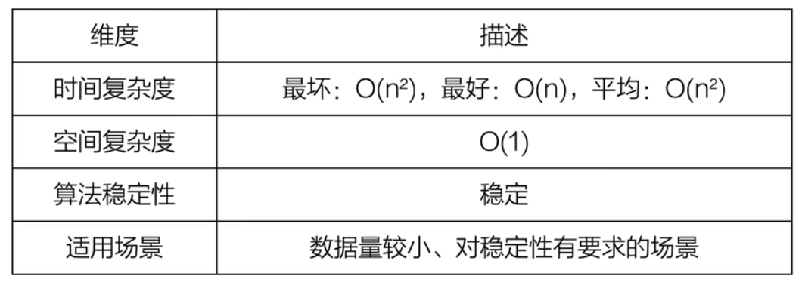
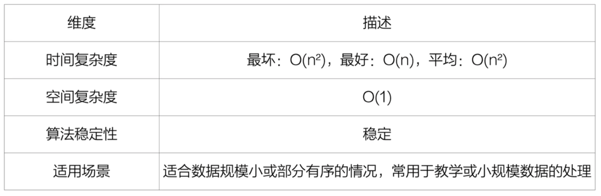
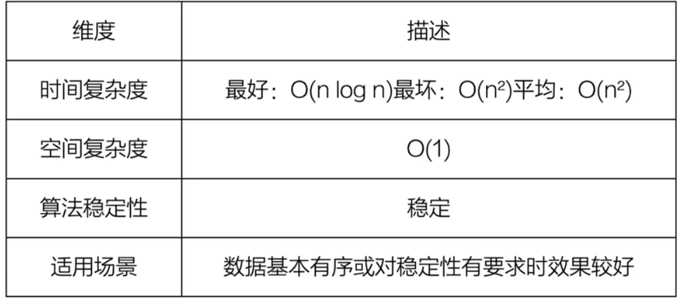
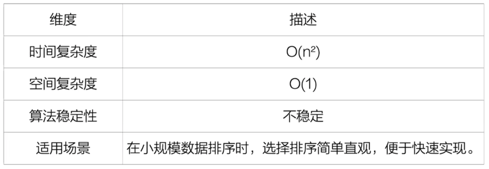
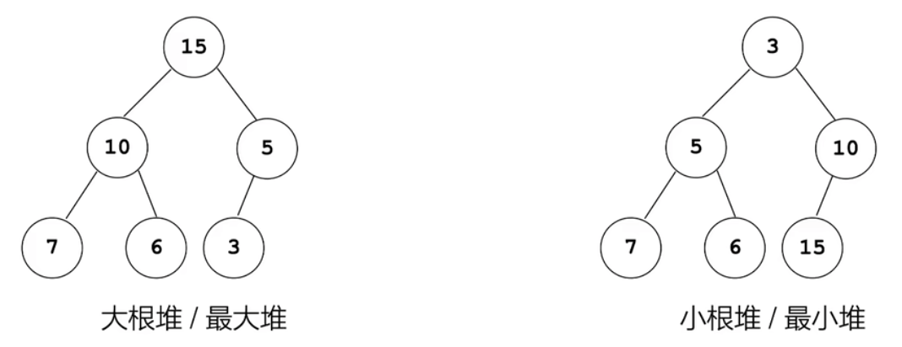
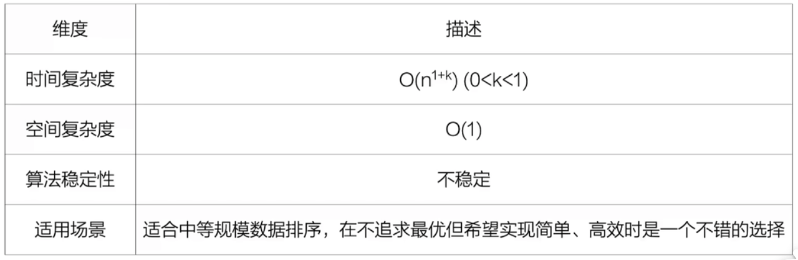
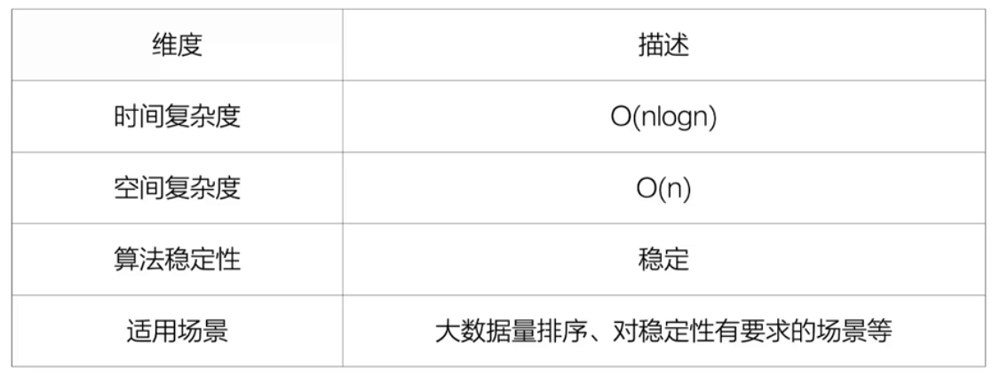
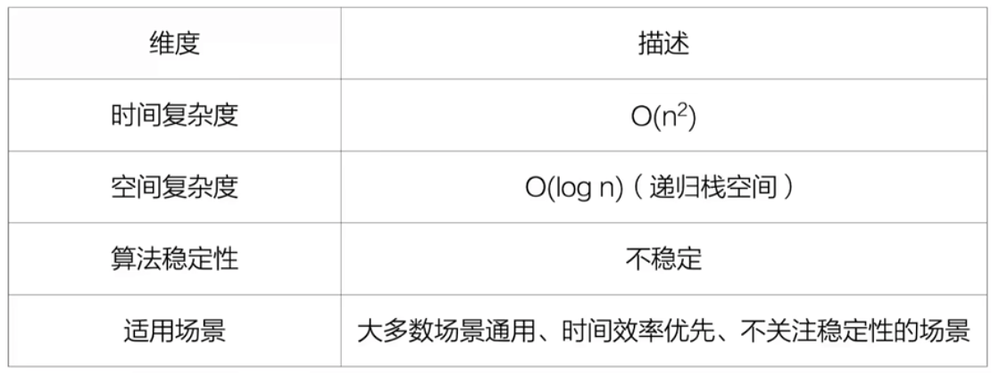
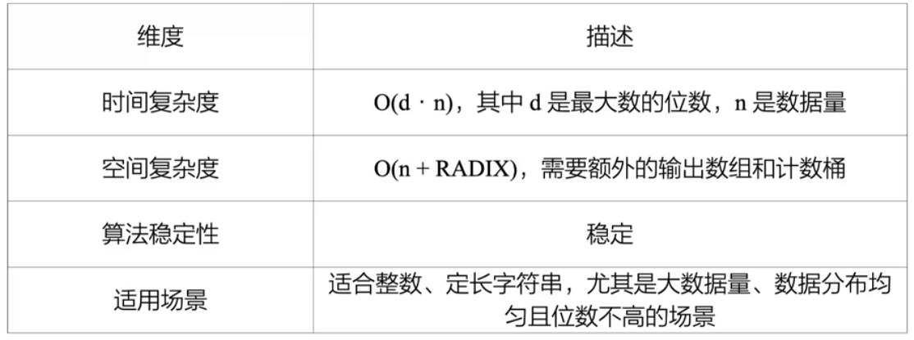

## 简单的内部排序
将一组数据元素按照某种规则（通常是关键字的大小）重新排列成有序的过程。
排序算法的三个核心指标：
- 时间复杂度：排序一组规模为n的数据，算法需要自信多少次基本操作？这会直接影响排序效率。
- 空间复杂度：排序过程中需要使用多少额外的内存空间？
- 排序稳定性：排序前后，相等元素之间的相对顺序是否保持不变？

### 排序算法 - 冒泡排序

冒泡排序特点

### 排序算法 - 插入排序
排序算法特点

### 排序算法 - 折半插入排序
节省了比较的次数。
折半排序算法特点

### 排序算法 - 简单选择排序
简单选择排序特点
<Sel-1.png>

### 堆与堆排序
堆排序(Heap Sort)是一种基于完全二叉树结构的选择排序，它利用堆这种特殊的数据结构来选出当前无序部分的
最大(或最小)元素，进而完成排序操作。

#### 堆
这里的“堆”不是平时程序中提到的“内存堆区”，而是一种满足特定性质的树状结构。
在堆排序中，通常使用的是**大根堆/最大堆**(每个节点都大于等于其子节点)或
**小根堆/最小堆**(每个节点都小于等于其子节点)。如下图：

<Heap-exp.png>

#### 堆的插入操作
- 保证形态为完全二叉树的基础上插入；
- 逐层调整。
#### 堆的删除操作
- 用最后一个结点替换要删除的节点，把最后一个结点删除掉。层序遍历依次编号中最后一个编号的就是最后一个结点
- 逐层调整，并保证是完全二叉树的形态。

#### 堆排序
1. 根据待排序的数组，构建二叉树。
根据层序 第一层为a[0],第二层为a[1],a[2], 第三层为a[3],a[4],a[5],a[6];以此类推。

2. 建堆：从最后一个非叶子结点开始向前遍历，每个结点都自信一次向下调整，最终构成一个大根堆。

3. 建好大根堆后，根结点就是数组中的最大值。保存起来。
在堆中删除根结点后（按照堆的删除操作删除根结点），再建堆，得到的根结点就是“第二个”最大值。以此类推完成排序。

## 一些高效的内部排序算法

### 希尔排序 Shell Sort
希尔排序的思路来自于能不能让数据基本有序，再进行排序。
核心思想是：先按一步“定长”分组进行排序，逐步减小步长，最终步长为1时完成最终的排序。

最初步长一般设为[n/2],n为数组中元素个数。下一次循环的步长为它除以2.

步长的选择非常关键，目前还是一个数学难题，没有找到一个最好的步长序列。
注意，最后一个步长必须为1.

希尔排序总结

### 归并排序 Merge Sort
归并排序是一种典型的“分治合”思想的应用。简单来说，它的做法是：
把一个大问题，拆成小问题分别解决，再把解决后的结果合并起来。
分：就是把数组分成两半，一直分，知道每个子数组只剩一个元素。
治：就是递归地堆每个子数组排序
合：把两个有序的子数组合并成一个有序数组。

递归实现可以画一下.注意什么是“一趟”。
递归排序总结

### 快速排序
快速排序是一种非常高效的排序算法，采用了分治思想（Divide and Conquer）。它的做法是：
1. 从序列中选择一个“基本元素”；
2. 将序列分为两个字序列，所有比基准元素小的放到左边，比基准元素大的放到右边；
3. 多左右两个字序列递归进行快速排序；
4. 知道字序列长度为1或0，排序完成。

注意什么是“一趟”。

快速排序总结

### 基数排序
它是一种“分配式”的排序方法，适用于整数排序，尤其在处理大批量数据时表现亮眼。
它的核心思想是：
把整数按“位”分配到不同的桶中，再按位合并，同多多轮这样的分配和合并，最终完成排序。
这个方法不需要两两之间比较。

基数排序总结

## 外部排序（External Sorting）
以上排序算法有一个共同点-它们都假设数据可以全部装入内存中进行处理。
然而，实际应用中有可能数据量非常庞大，远超主存能容纳的范围，比如包含十亿条激励的文件，
常规排序算法就无能为力。
为了解决这一问题，需要采用外部排序（External Sorting）技术。

外部排序是一种借助外部存储设备（如磁盘）完成排序的策略。它的基本思想是：将大文件分成
多个能装入内存的小块，每一块在内存中完成排序，然后再将这些有序的小块归并为一个整体有序文件。

外部排序所需时间=内部排序时间+归并排序时间 （其中包含了磁盘与内存读写时间）

由于外存访问速度远低于内存访问速度，一次完整的外部排序往往需要大量的磁盘读写过程，
I/O时间通常占据了整个排序过程的绝大部份。

k路归并：对同一个文件，归并路数越大，归并趟数越小，所需磁盘读写次数也越少。

归并趟数 $s=[log_k^m]$,向上取整
其中k为归并路数，m为初始归并段数.

提升外部排序效率：增加归并路数k，减少初始归并段个数m.
k越大，所需的内存空间也越大，缓冲区的个数变多，生成归并段也会变长，归并段的个数就会下降。

为了解决增加归并路数k而产生的比较次数多的问题，引入了多路平衡归并的方法。
为了减少初始归并段个数问题，引入了置换-选择排序的方法。
下面分别阐述。

### 多路平衡归并
解决路数增加，再内存中比较次数也增加的问题。比如有k路，则内存中每个元素，要比较k-1次，若每路有n个元素，则一趟时间开销为O(n(k-1)).
多路平衡归并就是解决这个问题。
它引入了败者树

<FAIL-TREE-1.png>

每一路都选出最小的数出来，两两相比，输的一方（小的数）向上一层
比如：1比8小，1上升一层；3比5小，3上升一层；1又比3小，3再上一层到了根 （还是比较了3次），它可以出来进输出缓冲区作为最小数
但第二次，因为3没上去看所以右边不用再出一个数比较。
左边R2在出一个数2，同理比较2次即可到根，省了一次3和5比较。

### 置换-选择排序
**见视频**
通过置换-选择排序后生成的归并段中元素个数可能不同。
这种情况下，我们可以利用哈夫曼树的思路构建归并树，这就叫最佳归并树。

如何创建最佳归并树？ 增加虚段，权值为0
k叉最佳归并树，度为k的结点个数为$n_k$,度为0的结点个数为$n_0$.
结点总数: $n=n_0+n_k$
结点总度数: $kn_k=n-1$
有 $kn_k+1=n=n_0+n_k$
$kn_k -n_k=n_0-1$
$n_k(k-1)=n_0-1$
$n_k=\frac{n_0-1}{k-1}$
$n_0$为初始归并段个数+虚段的个数
能整除，这可以确定虚段个数
