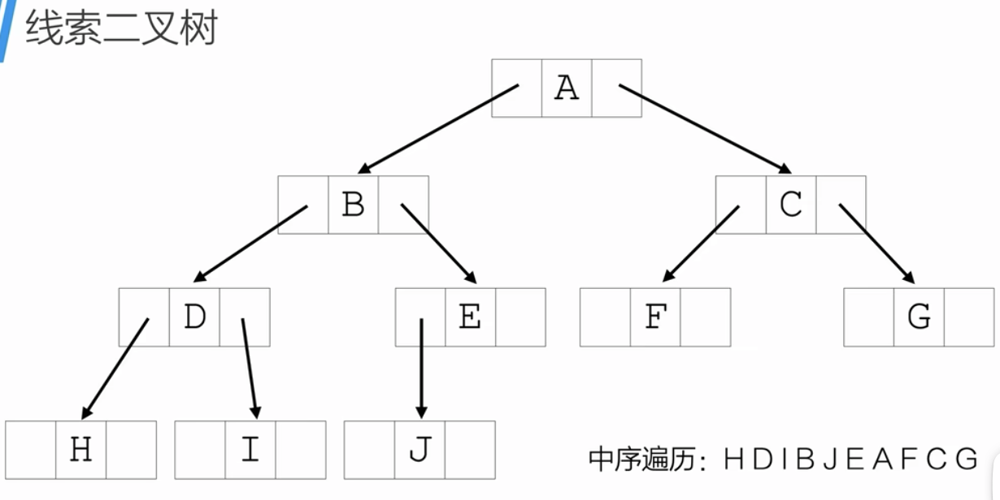
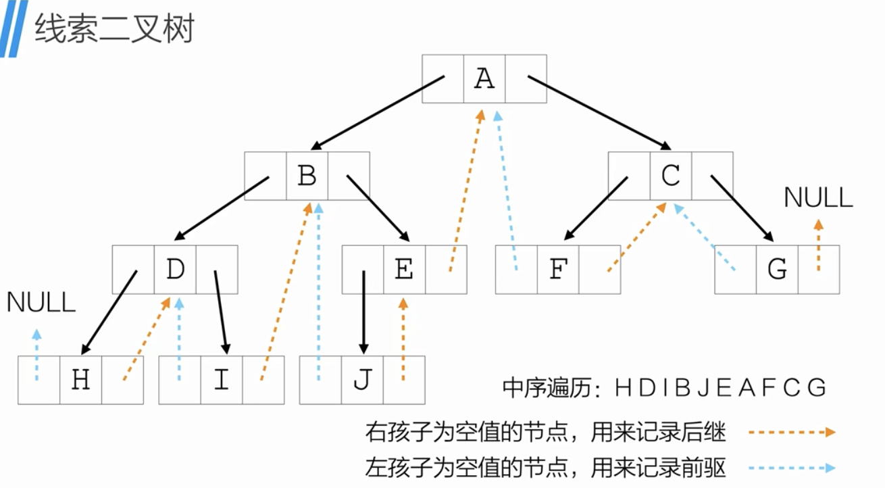
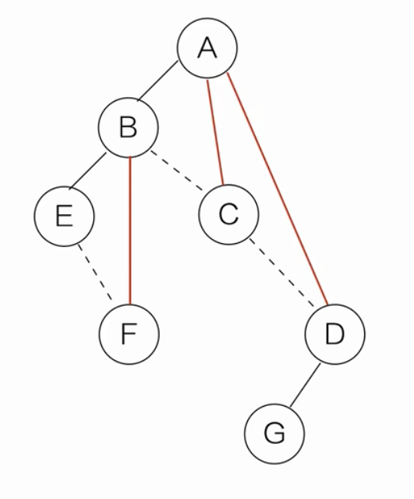
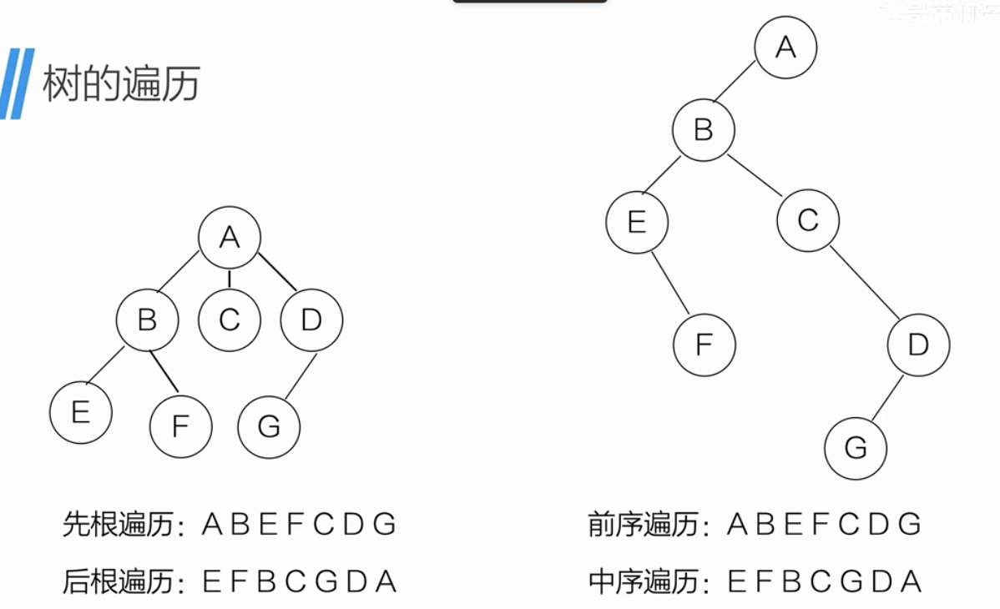
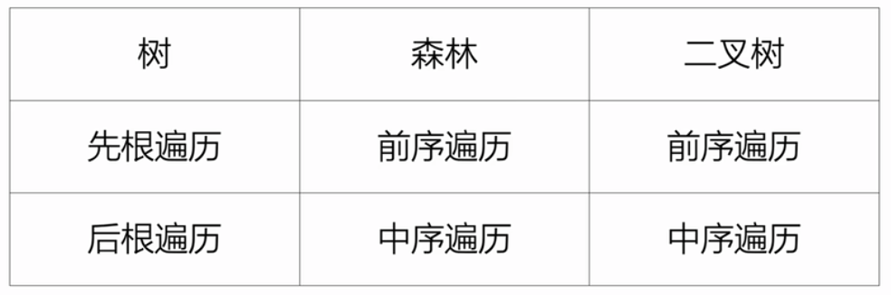

## 树的基本性质
- 性质1: 树中所有结点数等于所有节点的度数之和加1.
- 性质2: 对于度为m的树，第i层上最多有$m^{i-1}$个结点.
- 性质3: 对于层数（高度）为h，度为m的树，最多有$\frac{m^{h}-1}{m-1}$个结点.
- 性质4: 树中结点数比边数多1.

## 二叉树（Binary Tree）
对于非空二叉树：
- 每个结点至多只有两棵子树；
- 二叉树的子树有左右之分，**其次序不能任意颠倒**.

### 二叉树的性质
- 性质1: 二叉树的第i层至多有$2^{i-1}(i \ge 1)$个结点.
- 性质2: 深度为k的二叉树最多有$2^k-1(k \ge 1)$个结点.
- 性质3: 对于任何非空的二叉树T，如果叶子结点的个数为$n_0$,而度为2的结点数为$n_2$,则$n_0=n_2+1$

满二叉树：深度为$k (k \ge 1)$且含有$2^k-1$个结点的二叉树.
完全二叉树：深度$k (k \ge 1)$，有$n$个结点的二叉树，当且仅当其每一个结点都与深度为$k$的满二叉树中编号从1至$n$的结点一一对应时，称之为完全二叉树.
完全二叉树的特点：
（1）叶子结点只能在层次最大的两层上出现；
（2）对任一结点，若其右分支下的子孙的最大层次为m，则其左分支下的子孙的最大层次为m或m+1.

完全二叉树的口诀：没有完全左子树，不能有右子树；上一层没有铺满，不能有下一层.
(3)具有n个结点的完全二叉树的深度为$log_2^n+1$(floor)
(4) ...

(5) 已知二叉树的前序遍历和中序遍历，且树中元素关键字不同，则可以唯一确定一颗二叉树。

关键利用三种遍历的性质：
前序：根 → 左子树 → 右子树，所以前序的第一个元素一定是根。
中序：左子树 → 根 → 右子树，所以在中序里找到根后，根左边是左子树全部节点，根右边是右子树全部节点。

由此得到一个递归的划分过程：
前序第一个元素 root 就是当前子树的根。
在中序序列中找到 root 的位置，它把中序切成两段：
左段 = 左子树的中序序列
右段 = 右子树的中序序列
根据左子树的节点个数 k，在前序里根之后取 k 个作为左子树的前序，剩下的是右子树的前序。
对左右子树递归重复上述过程。
每一步的划分都是唯一的（前提是根在中序中只出现一次），所以整棵树唯一确定。

(6) 已知二叉树的中序遍历和后序遍历，且树中元素关键字不同，则可以唯一确定一颗二叉树。
利用两种遍历的性质：
后序：左子树 → 右子树 → 根，所以后序的最后一个元素一定是根。
中序：左子树 → 根 → 右子树，所以在中序里找到根后，根左边是左子树全部节点，根右边是右子树全部节点。
递归划分过程：
后序最后一个元素 root 是当前子树的根。
在中序中找到 root 的位置，把中序切成左段（左子树中序）和右段（右子树中序）。
设左子树节点个数为 k，则后序中前 k 个是左子树后序，接着的若干（右子树节点个数）个是右子树后序，最后一个才是根。
对左右子树递归重复。
每一步划分都唯一（根在中序中只出现一次），所以整棵树唯一确定。

(7)但是已知前序遍历和后序遍历的结果，则无法唯一确定一颗二叉树.
是因为两者都只能确定根，却无法判断某段节点属于左子树还是右子树。

(8)已知层序(从上到下，从左到右遍历)和中序
但层序+前序或后序则不能唯一确定二叉树。
唯一确定二叉树需要两类信息：
能定根的序列（前序第一个、后序最后一个、层序第一个都行）。
能划分左右子树的序列——只有中序能做到。
层序和前序都只能定根，都不能划分左右子树。两者组合，缺了"分左右"的关键信息，所以不唯一。

### 二叉树的顺序存储
顺序存储的核心是用数组下标表示结点间的关系：
根放在下标 1（或 0，看约定）
下标 i 的左孩子 = 2i，右孩子 = 2i+1
这个映射要求下标与树中位置严格对应。如果某个位置是空的却不留槽位，后面的结点下标就会错位，2i、2i+1 的公式立刻失效。所以空位必须"占着"，只是里面存一个空标记（如 '#'、0 或特殊值）。

关于"叶子结点后面也要占 2 个存储空间"
这个说法要分两种情况理解：

1. 若叶子结点是"最末尾的结点"（其孩子位置超出数组已用范围）
严格按"完全二叉树的位置映射"来说，叶子结点在数组中的 2i、2i+1 位置理论上对应空孩子。但实践中不必真的分配这两个槽位——数组长度只需覆盖到"最后一个实际结点"即可，末尾之外的空孩子位置可以省略，不需要额外占空间。

2. 若叶子结点不是末尾（后面还有别的结点）
那么它 2i、2i+1 这两个空孩子位置夹在数组中间，就必须保留占位，不能省。

正因空结点要占位，顺序存储对稀疏的二叉树（尤其是单支树）浪费极大。例如一棵只有 n 个结点、深度为 n 的单支树，数组需要 2^n - 1 量级的空间，几乎全空。所以顺序存储只适合完全二叉树 / 满二叉树；一般二叉树更常用链式存储。

## 线索二叉树
通过遍历可以得到二叉树的线性排列，但这样的线性序列只有在遍历时才能得到。
将二叉树线索化（Index）得到线索二叉树可以解决这个问题.
线索化：利用叶结点的剩余空间记录前驱和后继.

若一颗二叉树有n个结点，那么存在n+1个空余空间记录前驱和后继。

代码中如何区分是孩子还是线索？
结构中增加2个成员`int ltag,rtag;`
ltag,rtag: 0表示孩子；1表示线索

除了增加`ltag，rtag`区分孩子和线索之外，还要做以下4件事：
以中序遍历线索化为例：
（1）增加一个头节点指向二叉树的根；
（2）头结点的rchild指向遍历的最后一个结点；
（3）第一个结点的lchild指向头结点；
（4）最后一个结点的rchild指向头结点.

做好后，就相当于一个循环链表.

## 哈夫曼树
### 基本概念
路径：从树中一个结点到另一个结点之间的分支构成这两个结点之间的路径。
路径长度：路径上的分支数目
树的路径长度：从树根到每一个结点的路径之和.
结点的权：在实际应用中，给树中的结点赋予代表某种含义的数值。
结点的带权路径长度：从该结点到树根之间的路径长度与结点权的乘积。
树的带权路径长度（WPL）:树中所有叶子结点的带权路径长度之和。
带权路径长度（WPL）最小的二叉树成为哈夫曼树.

### 构造哈夫曼树
1. 先把有权值的叶子结点按照从小到大的顺序排成一个有序数列.
如：不及格5； 优秀10；及格15；良好30；中等40

2. 取两个最小权值的结点作为一个新结点N1的子结点,N1的权值为两个子结点权值之和.权值小在左结点，权值大在右结点.
3. 将结点N1替换刚取出的两个结点，并加入到有序数列中.
4. 重复步骤2，将N1和“及格”作为一个新结点N2（权值为30）的子结点
5. 一直重复，直到形成一个二叉树.

权值越大，离树根越近.

### 哈夫曼编码
为了解决远距离通信的数据传输最优化问题.

## 树与二叉树的转换
### 树转换为二叉树
1. 加线，在所有兄弟之间加一条线；
2. 去线，对树中每一个结点，只保留它与第一个孩子的连线，删除它与其他孩子结点之间的连线；
3. 层次调整，以树的根结点为轴心，将整颗树顺时针旋转一定角度，使之层次分明。

### 二叉树转换为树
1. 加线，若某个结点的左孩子存在，则将这个左孩子的所有右孩子结点都作为此结点的孩子，将
该结点与这些右孩子结点用线连起来。
2. 去线，删除**二叉树**中所有结点与其右孩子结点的连线.

3. 调整，转一下.

### 森林与二叉树的转换
森林：多棵树的集合.
1. 先把每棵树转换为二叉树
2. 第一棵二叉树不动，从第二棵树开始，依次把后一棵二叉树的根结点作为前一刻二叉树的根结点的右孩子，然后用线连起来。

### 二叉树转森林
1. 从根结点开始，若右孩子存在，则把右孩子结点的连线删除.
2. 拆
3. 把二叉树转换为树

## 树（不是二叉树）和森林的遍历
先根遍历和后根遍历

一棵树的先根遍历结果与它形成的二叉树前序遍历结果相同。
一棵树的后根遍历结果与它形成的二叉树中序遍历结果相同。

森林有前序遍历和中序遍历（没有后序遍历）
森林的前序遍历就是每棵树的先根遍历拼接起来。
森林的中序遍历就是每棵树的后根遍历拼接起来。

树、森林与二叉树的遍历关系

## 层序遍历
